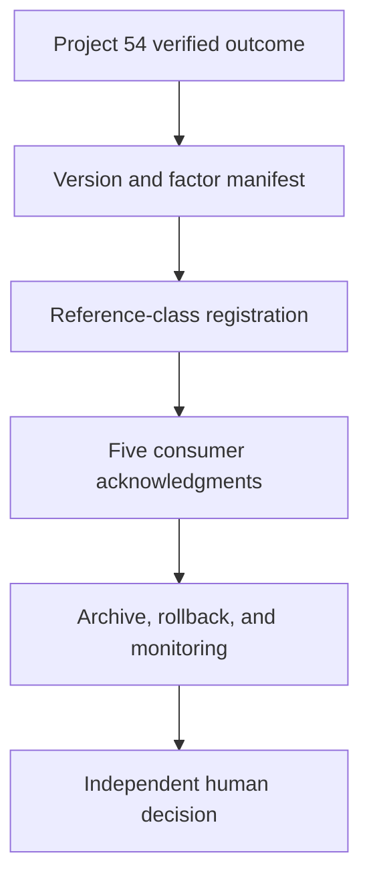

# Roadmap Recalibration Baseline Handoff Controller

Project 55 closes the operational consistency gap after Project 54 verifies a promoted calibration outcome. It confirms that every governed roadmap-estimation consumer acknowledges one authoritative baseline, while preserving the superseded version, rollback, and future monitoring.

## Why it matters

A verified version can still produce unreliable decisions if the scheduler uses it while effectiveness or drift monitoring compares against an older baseline. This controller makes that split-brain condition visible before a human completes the handoff.

## Flow



## Required consumers

| Consumer | Purpose |
|---|---|
| Roadmap scheduler | Creates the governed delivery baseline |
| Estimate adoption | Applies factors to explicit estimate bases |
| Estimate effectiveness | Compares later actuals with the correct version |
| Estimate drift | Builds chronological reliability windows |
| Recalibration controller | Uses the correct active version for future proposals |

The controller also requires exact Project 54 lineage, complete reference-class registration, an immutable superseded-version archive, current rollback, distinct effectiveness and drift ownership, independent approvals, and a named `complete_handoff`, `continue_transition`, or `rollback` review.

## Run

```bash
cd roadmap_recalibration_baseline_handoff_controller
npm test
npx wrangler dev
npx wrangler secret put API_TOKEN
npx wrangler deploy
```

Submit `POST /api/roadmap-recalibration-baseline-handoff` with `Authorization: Bearer <token>` and JSON containing `outcomeReport` and `input`. Requests are limited to 2 MB and cross-origin API calls are rejected.

## Boundaries

`baseline_handoff_complete` verifies supplied evidence and a named human decision. It does not change configurations, factors, estimates, schedules, consumer state, archives, monitoring, rollback, or product state. Manifest identifiers are traceability references, not digital signatures.

## Research basis

- [NIST SP 800-53 Rev. 5 configuration change control](https://csrc.nist.gov/pubs/sp/800/53/r5/upd1/final)
- [NIST SP 800-128 configuration management](https://csrc.nist.gov/pubs/sp/800/128/upd1/final)
- [NIST AI Risk Management Framework](https://www.nist.gov/itl/ai-risk-management-framework)
- [Google SRE release engineering](https://sre.google/sre-book/release-engineering/)

MIT licensed. No paid API, hosted model, database, or proprietary runtime dependency is required.
