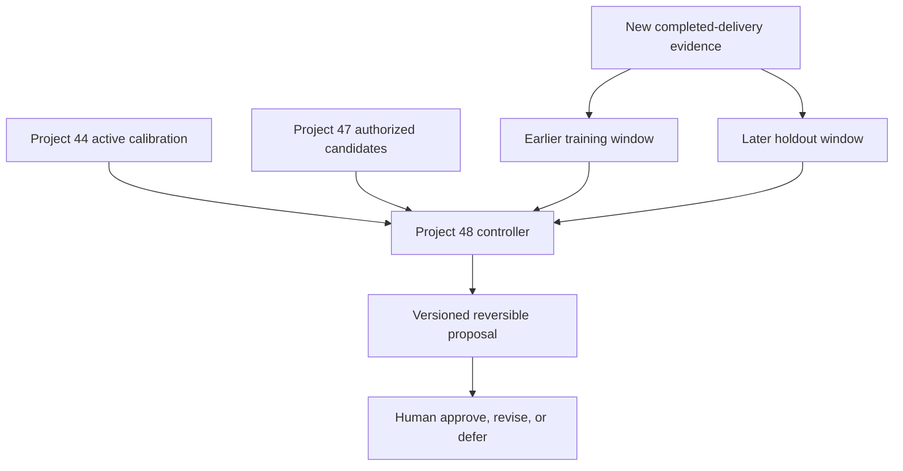

# Roadmap Estimate Recalibration Proposal & Validation Controller

**ProdMind Project 48** converts an authorized Project 47 drift signal into a bounded, versioned, holdout-tested recalibration proposal.

Project 44 establishes a reference-class calibration, Project 45 controls its use, Project 46 measures completed-outcome accuracy, and Project 47 detects longitudinal deterioration. Project 48 closes the next control gap: it prevents a team from responding to drift by silently replacing the active factors with values fitted to the same evidence used to judge them.

The project uses deterministic JavaScript, runs on Cloudflare Workers, and requires no paid model, database, or API.

## Decision it supports

Should a proposed replacement calibration be approved for a separately governed activation step, revised, or deferred?

The controller requires:

- An adopted Project 44 active calibration
- A Project 47 `recalibrate` decision with named reference-class candidates
- Newer completed-delivery observations with customer, delivery, and classification evidence
- Chronologically earlier training observations
- A later, untouched holdout for each candidate class
- Holdout accuracy and improvement over the active factors
- Bounded factor changes
- A new version and finite proposal lifetime
- A rollback target, owner, recovery objective, and evidence
- Distinct Product, Engineering, and Assurance approvals
- A named human `approve`, `revise`, or `defer` decision

It returns `approved_recalibration`, `blocked_recalibration`, or `action_required`.

Approval is not activation. The controller never changes an active factor, estimate, schedule, assignment, or product state; it does not evaluate people, guarantee future accuracy, or claim statistical significance.

## Connected architecture



The connected Project 7 endpoint reconstructs the current Projects 14, 40, 41, 44, 45, 46, and 47 chain server-side. The client supplies only additional historical delivery cases and classifications needed to construct a newer Project 44 evidence report, plus the explicit Project 48 policy and review.

## Deterministic validation method

For every Project 47 candidate reference class:

1. Sort observations by reviewed delivery timestamp and stable item ID.
2. Reserve the latest declared number of observations as a temporal holdout.
3. Require a minimum number of earlier training observations.
4. Calculate candidate duration and capacity factors with the declared nearest-rank percentile.
5. Apply both active and candidate factors to the untouched holdout.
6. Compare mean absolute error against actual duration and capacity.
7. Enforce accuracy, improvement, and factor-change limits.

This is a transparent policy control, not proof that one calibration is universally superior. Small samples, selection effects, changing scope, and future distribution shifts remain product risks.

## API

`POST /api/roadmap-recalibration`

```json
{
  "activeCalibrationReport": { "schemaVersion": "1.0.0", "status": "adopted_calibration" },
  "driftReport": { "schemaVersion": "1.0.0", "status": "action_required", "recalibrationCandidates": ["onboarding"], "review": { "decision": "recalibrate" } },
  "evidenceCalibrationReport": { "schemaVersion": "1.0.0", "observations": [] },
  "input": {
    "id": "recalibration-2027-q1",
    "asOf": "2027-03-02T00:00:00Z",
    "activeVersion": "estimate-policy-3",
    "proposedVersion": "estimate-policy-4",
    "validUntil": "2027-04-01T00:00:00Z",
    "minimumTrainingItemsPerClass": 4,
    "holdoutItemsPerClass": 2,
    "percentileRate": 0.75,
    "maximumFactorChangeRate": 0.5,
    "minimumHoldoutImprovementRate": 0.05,
    "maximumHoldoutErrorRate": 0.15,
    "rollback": {
      "targetVersion": "estimate-policy-3",
      "owner": "Delivery operations",
      "maximumRecoveryHours": 4,
      "evidence": "Previous policy bundle remains deployable."
    },
    "approvals": {
      "product": { "reviewer": "Product lead", "decision": "approve", "rationale": "Scoped approval.", "reviewedAt": "2027-03-02T01:00:00Z" },
      "engineering": { "reviewer": "Engineering lead", "decision": "approve", "rationale": "Rollback verified.", "reviewedAt": "2027-03-02T01:05:00Z" },
      "assurance": { "reviewer": "Independent assurance", "decision": "approve", "rationale": "Holdout verified.", "reviewedAt": "2027-03-02T01:10:00Z" }
    },
    "review": { "reviewer": "Estimation council chair", "decision": "approve", "rationale": "Bounded and reversible.", "reviewedAt": "2027-03-02T02:00:00Z" }
  }
}
```

Use `Authorization: Bearer <API_TOKEN>`. Requests are same-origin, JSON-only, limited to 2 MB, and validated before evaluation.

## Local development

```bash
npm install
npm test
npx wrangler dev
```

Create an uncommitted `.dev.vars` file:

```text
API_TOKEN=replace-with-a-long-random-secret
```

## Deploy

```bash
npx wrangler secret put API_TOKEN
npx wrangler deploy
```

Cloudflare account limits still apply. No paid dependency is introduced by this repository.

## Research basis

- [GAO Cost Estimating and Assessment Guide](https://www.gao.gov/products/gao-20-195g) emphasizes documented estimating methods, sensitivity and risk analysis, presentation, and updates using actual outcomes.
- [NASA Cost Estimating Handbook](https://www.nasa.gov/ocfo/ppc-corner/nasa-cost-estimating-handbook-ceh/) provides agency guidance for defensible cost estimating and analysis.
- [UK Cost Estimating Guidance](https://www.gov.uk/government/publications/cost-estimating-guidance/cost-estimating-guidance) ties reference classes and confidence levels to evidenced maturity rather than stage labels alone.
- [NIST AI RMF Core](https://airc.nist.gov/airmf-resources/airmf/5-sec-core/) reinforces documented testing, evaluation, validation, monitoring, change management, and human oversight. Project 48 uses those governance principles without claiming that its deterministic estimator is AI.

Project 48 adapts these principles to bounded product-roadmap estimates. It does not claim certified cost estimating, statistical model validation, or regulatory compliance.

## Documentation

- [Product requirements](docs/PRD.md)
- [Architecture and boundaries](docs/ARCHITECTURE.md)
- [Metrics](docs/METRICS.md)

## License

MIT
