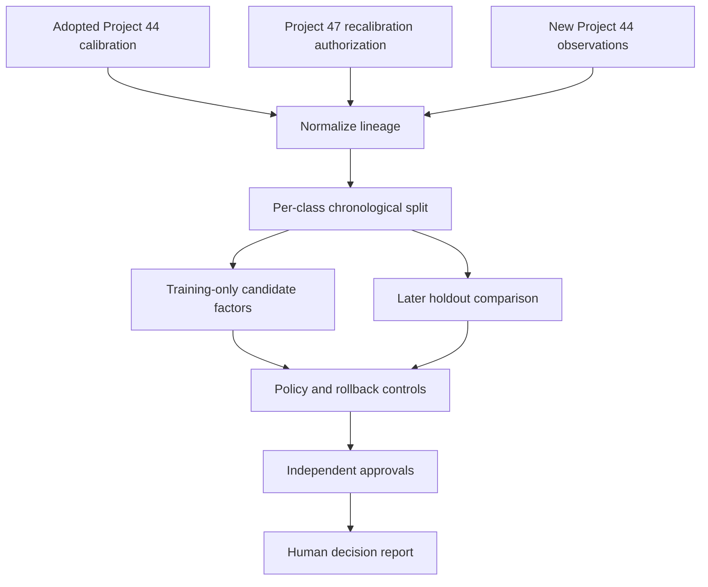

# Architecture and boundaries

## Components

| Component | Responsibility |
| --- | --- |
| `src/controller.js` | Validate lineage, create temporal splits, calculate factors and holdout errors, enforce controls, return the reviewed report |
| `src/worker.js` | Authenticate, enforce same-origin JSON requests, bound request bodies, route the API, and serve static assets |
| `public/` | Demonstrate the complete review flow without third-party scripts or services |
| `tests/` | Verify deterministic controls, security boundaries, invalid inputs, and human-decision states |

## Data flow

## Temporal split

Observations are ordered by `deliveryAsOf` and then stable `portfolioItemId`. The latest `holdoutItemsPerClass` observations are reserved. Candidate factors use only the remaining earlier rows. The report exposes the training and holdout IDs so reviewers can verify separation.

This is a deterministic holdout policy, not random sampling, cross-validation, or a statistical test. Chronology reduces one form of leakage but does not eliminate selection bias or distribution change.

## Security

- The API fails closed when `API_TOKEN` is absent.
- Bearer values are compared through fixed-length SHA-256 digests.
- Browser-originated API requests must be same-origin.
- Only exact `application/json` requests are parsed.
- Request bodies are limited to 2 MB.
- Responses disable storage and include CSP, content-type, referrer, framing, base, and form protections.
- The frontend constructs output with DOM text nodes rather than interpolating server content into HTML.
- Secrets remain Cloudflare bindings and are never returned or logged.

## Trust boundaries

The standalone endpoint validates submitted reports structurally. In the connected Project 7 route, the active chain through Project 47 is reconstructed server-side. Historical delivery cases remain supplied evidence and are disclosed as such; they are not independently verified merely because they pass schema checks.

## Decision boundary

`approved_recalibration` means the submitted proposal passed the declared controls. It does not activate the version, prove generalization, authorize schedule changes, guarantee future accuracy, or transfer accountability from human reviewers.
