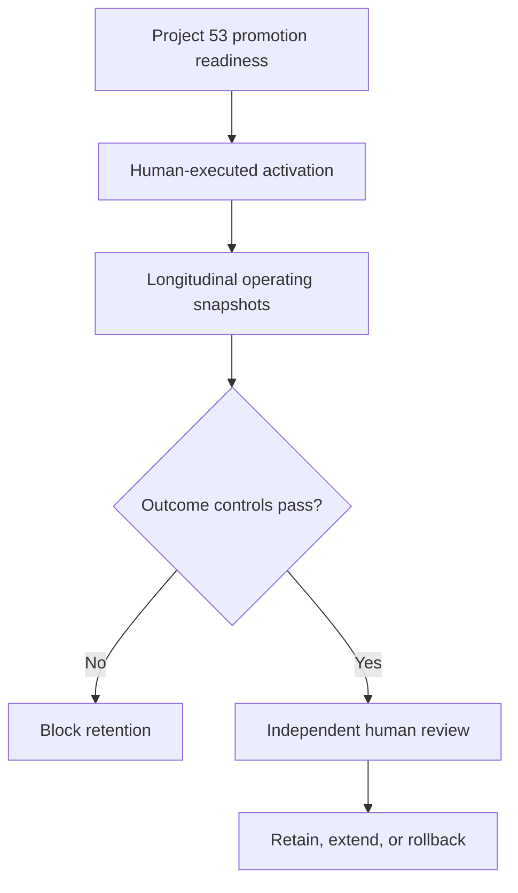

# Roadmap Recalibration Promotion Outcome Monitor

Project 54 verifies what happened after Project 53's human promotion decision. It separates “ready to promote” from “successfully activated and stable,” preserving a clear evidence trail from incident learning through full operating-baseline adoption.

## Why this project exists

A passing retry and promotion approval do not prove that the authorized version was activated everywhere or stayed healthy after broader use. This monitor checks the external change record and subsequent real-world observations before a human retains the baseline.

## Connected flow



## Deterministic controls

- Exact Project 53 authorization, prior version, candidate version, and timing
- Exact promoted version and scope in every snapshot
- Full declared adoption and minimum observation duration
- Maximum snapshot gaps and minimum samples
- Paired duration and capacity error by reference class
- Continued corrective-control health and non-recurrence
- Incident limits and recently tested exact rollback
- Review independent from promotion approval and execution

`verified_promotion_outcome` means the supplied evidence passes the configured controls and a named human selected `retain`. It does not change the active baseline or prove causality.

## Run

```bash
cd roadmap_recalibration_promotion_outcome_monitor
npm test
npx wrangler dev
npx wrangler secret put API_TOKEN
npx wrangler deploy
```

Submit `POST /api/roadmap-recalibration-promotion-outcomes` with `Authorization: Bearer <token>` and JSON containing `promotionReport` and `input`. Requests are limited to 2 MB and cross-origin API calls are rejected.

## Layout

| Path | Purpose |
|---|---|
| `src/outcomes.js` | Pure activation and longitudinal outcome controls |
| `src/worker.js` | Authenticated Cloudflare Worker API |
| `public/` | Responsive light/dark interface |
| `test/` | Engine and HTTP-boundary tests |
| `docs/` | PRD, architecture, and metrics |

## Boundaries

The monitor validates supplied evidence. It never activates or reverts a version, edits factors or estimates, changes exposure, removes rollback, evaluates individuals, or claims statistical significance or causality.

## Research basis

- [Google SRE Workbook: Canarying Releases](https://sre.google/workbook/canarying-releases/)
- [NIST AI Risk Management Framework 1.0](https://www.nist.gov/itl/ai-risk-management-framework)
- [NIST SP 800-137: Continuous Monitoring](https://csrc.nist.gov/pubs/sp/800/137/final)
- [GAO Cost Estimating and Assessment Guide](https://www.gao.gov/products/gao-20-195g)

MIT licensed. No paid API, hosted model, database, or proprietary runtime dependency is required.
