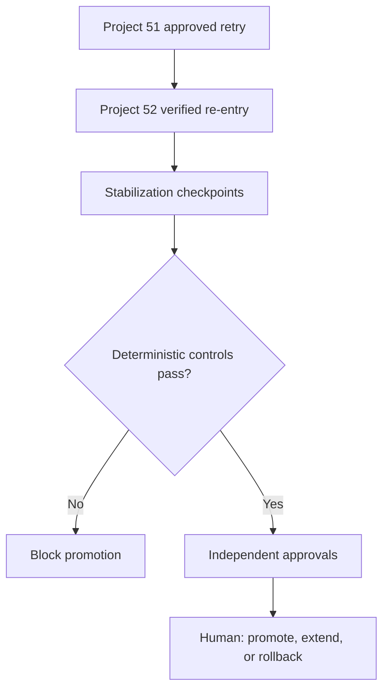

# Roadmap Recalibration Re-entry Promotion Controller

Project 53 closes the recovery loop after a previously failed roadmap-estimation recalibration. Project 51 authorizes a bounded retry and Project 52 verifies that retry. This project determines whether evidence has remained healthy long enough for an independent human to promote the candidate as the durable operating baseline.

## Why this project exists

A canary that looks safe at its final stage can still hide delayed regression, a failed corrective control, a stale rollback path, or a weak reference class. Promotion therefore needs a separate decision boundary from trial continuation.

The design follows Google SRE guidance to compare candidates with controls and observe gradual releases, NIST AI RMF guidance for post-deployment monitoring, recovery, and change management, and NIST continuous-monitoring guidance for ongoing visibility into control effectiveness.

## Decision flow



## What is checked

- Exact Project 51 → 52 lineage, candidate version, baseline, and scope
- Chronological checkpoint coverage and maximum observation gaps
- Paired duration and capacity error by reference class
- Minimum samples, maximum error, minimum improvement, and incident guardrails
- Continued corrective-control health and absence of known-condition recurrence
- Exact, owned, time-bounded, recently tested rollback
- Independent Product, Delivery, Assurance, and final review

`ready_for_promotion` means the supplied evidence satisfies configured deterministic rules and the named human selected `promote`. It does not activate the candidate or establish causality.

## Run locally

```bash
cd roadmap_recalibration_reentry_promotion_controller
npm test
npx wrangler dev
```

Set the deployment secret and deploy on Cloudflare's free tier:

```bash
npx wrangler secret put API_TOKEN
npx wrangler deploy
```

Submit `POST /api/roadmap-recalibration-reentry-promotion` with `Authorization: Bearer <token>` and JSON containing `learningReport`, `assuranceReport`, and `input`. The body is limited to 2 MB, cross-origin API requests are rejected, and error responses do not expose secrets.

## Repository layout

| Path | Purpose |
|---|---|
| `src/promotion.js` | Pure validation, aggregation, and promotion controls |
| `src/worker.js` | Authenticated Cloudflare Worker interface |
| `public/` | Responsive system-aware light/dark UI |
| `test/` | Engine and HTTP-boundary tests |
| `docs/` | PRD, architecture, and metrics |

## Limits

The controller validates supplied evidence; it does not independently verify source truth or statistical significance. It never changes exposure, activates or promotes a version, edits factors or estimates, removes rollback, or executes rollback. Those remain explicit external operations owned by named humans.

## Research

- [Google SRE Workbook: Canarying Releases](https://sre.google/workbook/canarying-releases/)
- [NIST AI Risk Management Framework 1.0](https://www.nist.gov/itl/ai-risk-management-framework)
- [NIST SP 800-137: Information Security Continuous Monitoring](https://csrc.nist.gov/pubs/sp/800/137/final)

MIT licensed. No paid API, hosted model, database, or proprietary runtime dependency is required.
